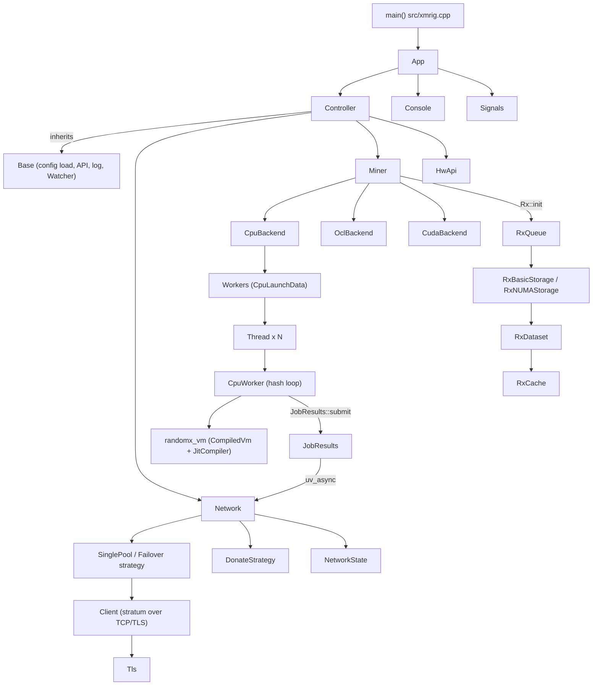

# 01 — Architecture and module map

XMRig 6.27.0 is a single C++11 executable built around one **libuv event loop** (main
thread) plus a set of **worker threads** that do the hashing. Everything that touches the
network, config, console, API and timers runs on the event loop; hashing never does.

## Threads at runtime (typical `rx/0` CPU mining)

| Thread | Created by | Job |
|---|---|---|
| main / libuv loop | `App::exec()` → `uv_run` | config, console keys, signals, DNS, TCP/TLS, stratum JSON, timers (`Network::tick` every 1 s, `Miner` timer every 500 ms), API, result submission |
| RxQueue background thread | `RxQueue` ctor (`src/crypto/rx/RxQueue.cpp`) | waits for a new seed, then (re)builds the RandomX cache + dataset |
| dataset-init threads (transient) | `RxDataset::init()` | split the 2 GiB dataset init across N threads, then exit |
| CPU workers (N) | `Workers<CpuLaunchData>::start` → `Thread::start` (`src/backend/common/Thread.h`) | `CpuWorker<1>::start()` — the infinite hash loop |
| libuv threadpool (lazy) | `uv_queue_work` | only used for GPU result re-verification (`JobResults.cpp`) |

Worker ↔ event-loop communication is lock-free or near-lock-free:
* **Job hand-off**: `Nonce::m_sequence` (atomic counter) is bumped by `Nonce::touch()`; each
  worker compares its cached sequence (`Nonce::isOutdated`) once per hash and copies the
  new job when it changes (`Worker::consumeJob` → `WorkerJob::add`).
* **Nonce space**: a global atomic `Nonce::m_nonces[index]` from which workers reserve
  32768 nonces at a time (`kReserveCount`, `CpuWorker.cpp`).
* **Results**: `JobResults::submit()` pushes into a mutex-protected list and wakes the loop
  with `uv_async_send` (`src/net/JobResults.cpp`).
* **Hashrate**: workers only bump a counter (`m_count`); the loop samples it every 500 ms
  (`Workers::tick` → `Hashrate::add`).

## Source tree map (`src/`)

| Path | Files | Responsibility |
|---|---|---|
| `xmrig.cpp`, `App*.cpp`, `Summary.cpp` | — | `main()`, app lifecycle, the startup banner |
| `core/` | 13 | `Controller` (owns Network + Miner), `Miner` (job → backends), `config/` (`Config`, CLI table `Config_platform.h`, `ConfigTransform`, `usage.h`) |
| `net/` | 8 | `Network` (glue between strategies and Miner), `JobResults`, `strategies/DonateStrategy` |
| `base/` | 209 | Reusable framework: `kernel/` (Base, Process, Platform_*, Entry), `net/stratum/` (Client, Job, Pool, Pools, Url, strategies, Tls, Socks5, DaemonClient, SelfSelectClient, benchmark/), `net/tls`, `net/http(s)`, `net/dns`, `io/` (Console, Signals, Watcher, log, json), `api/`, `crypto/` (Algorithm, Coin, keccak, sha3), `tools/` |
| `backend/common/` | — | Backend-agnostic: `Workers`, `Thread`, `Worker`, `WorkerJob`, `Hashrate`, `benchmark/` |
| `backend/cpu/` | — | `CpuBackend`, `CpuConfig` (+ `CpuConfig_gen.h` auto-config), `CpuWorker` (**the hash loop**), `platform/` (CPU detection: `BasicCpuInfo_*`, `HwlocCpuInfo`) |
| `backend/opencl/`, `backend/cuda/` | — | GPU backends (OpenCL kernels incl. RandomX; CUDA via external plugin) |
| `crypto/rx/` | — | XMRig's RandomX orchestration: `Rx`, `RxQueue`, `RxBasicStorage`/`RxNUMAStorage`, `RxDataset`, `RxCache`, `RxVm`, `RxAlgo`, `RxConfig`, `RxMsr`/`RxFix` (x86 MSR mod, Linux/Windows only), `Profiler` |
| `crypto/randomx/` | — | Forked & heavily optimised RandomX library: VM, JIT compilers (`jit_compiler_x86*`, `jit_compiler_a64*`, `jit_compiler_rv64*`), AES generators/hash, Blake2b, superscalar, dataset, allocators |
| `crypto/common/` | — | `VirtualMemory*` (huge pages, JIT memory, NUMA pools), `Nonce`, `MemoryPool`, `Assembly` |
| `crypto/cn`, `argon2`, `kawpow`, `ghostrider` | — | Other algorithm families (not used for Monero) |
| `hw/` | 21 | `msr/` (x86 MSR read/write), `dmi/` (SMBIOS), `api/` (HwApi) |
| `3rdparty/` | 131 | rapidjson, fmt, llhttp, getopt, argon2, libethash, epee, CL headers, ADL |

## Object ownership graph

## Key interfaces (listener pattern everywhere)

* `IStrategyListener` (`Network`): `onActive`, `onJob`, `onLogin`, `onPause`, `onResultAccepted`, `onVerifyAlgorithm`.
* `IClientListener` (strategies): `onJobReceived`, `onLoginSuccess`, `onClose`, `onResultAccepted`.
* `IJobResultListener` (`Network::onJobResult`): results coming back from workers.
* `IBackend` (`CpuBackend`, `OclBackend`, `CudaBackend`): `prepare(job)`, `setJob(job)`, `start(worker, ready)`, `stop()`, `tick()`, `hashrate()`.
* `IRxListener` (`Miner::onDatasetReady`): fired on the loop thread when a dataset finishes.
* `IBaseListener` (`onConfigChanged`): hot reload from `config.json` (Watcher) or HTTP API PUT.

## Build-time feature switches that matter for performance

| CMake option | Default | Effect |
|---|---|---|
| `WITH_RANDOMX` | ON | RandomX family (Monero). Forces `WITH_ARGON2` on (cache init). |
| `WITH_ASM` | ON | x86-64 only: CryptoNight asm + **x86 RandomX JIT**. ARM64 JIT is always built on ARMv8. |
| `WITH_HWLOC` | ON | Topology-aware thread auto-config + NUMA dataset copies. **On ARM it only enumerates PUs** (`HwlocCpuInfo::allThreads`). |
| `WITH_MSR` | ON | x86 + Linux/Windows only: MSR mod (+up to ~15% on Ryzen/Intel). Not on macOS. |
| `WITH_SECURE_JIT` | OFF (**forced ON on Apple ARM64**, `cmake/os.cmake`) | W^X JIT pages; on macOS uses `MAP_JIT` + `pthread_jit_write_protect_np`. |
| `WITH_PROFILING` | OFF | rdtsc-based per-stage profiler (x86 only as written). See `10-benchmarking-and-profiling.md`. |
| `WITH_BENCHMARK` | ON | `--bench`, `--stress`. |
| `WITH_OPENCL` / `WITH_CUDA` | ON | GPU backends (OpenCL is deprecated on macOS). |
| `WITH_AVX2`, `WITH_SSE4_1`, `WITH_VAES` | ON | x86-only Blake2b / AES variants; forced off on ARM. |

Compiler flags (`cmake/flags.cmake`, `cmake/cpu.cmake`): GCC Release `-Ofast`; Clang Release
`-O3 -funroll-loops -fmerge-all-constants`; ARM64 adds `-march=armv8-a+crypto`, or
`-mcpu=native` when the build host is an **Apple M4 or newer** (detected via
`sysctl machdep.cpu.brand_string`). Measured: GCC vs Clang build gave the same hashrate
(1967 vs 1952 H/s, within noise) because >95% of time is in JIT-generated code.
