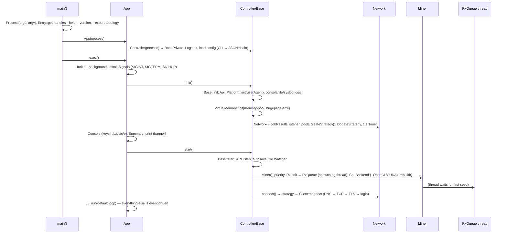

# 02 — Startup and configuration flow

## Your command line, decoded

```
xmrig -o xmr-us-west1.nanopool.org:14433 -u <WALLET> --tls --coin monero
```

`BaseTransform::load()` (`src/base/kernel/config/BaseTransform.cpp`) runs `getopt_long`
over the option table in `src/core/config/Config_platform.h` and turns every flag into a
JSON document, as if you had written a `config.json`:

| Flag | Handler | Resulting JSON |
|---|---|---|
| `-o host:14433` | `UrlKey` → pushes a new object into `pools[]` | `pools[0].url = "xmr-us-west1.nanopool.org:14433"` (no scheme ⇒ plain stratum; TLS comes from `--tls`) |
| `-u <WALLET>` | `UserKey` → `add()` to the last pool | `pools[0].user = "<WALLET>"` |
| `--tls` | `TlsKey` → `transformBoolean` | `pools[0].tls = true` (14433 is nanopool's TLS port) |
| `--coin monero` | `CoinKey`; pools exist ⇒ `add()` | `pools[0].coin = "monero"` → `Coin::parse` matches name "Monero" ⇒ `Coin::MONERO` |

Everything else comes from defaults:

| Setting | Default | Where |
|---|---|---|
| password | `"x"` | `Pool::kDefaultPassword` |
| donate-level | **1 %** (1 min every 100 min; min 1 unless you edit `src/donate.h`) | `src/donate.h`, `DonateStrategy` |
| retries / retry-pause | 5 / 5 s | `Pools.h` |
| keepalive | off (enabled automatically if the pool advertises the `keepalive` extension) | `Client::parseExtensions` |
| CPU threads | auto (see `04-mining-pipeline.md`; **on Apple Silicon: one per core, P + E**) | `CpuConfig_gen.h`, `HwlocCpuInfo::allThreads` / `BasicCpuInfo::threads` |
| `cpu.priority` | `-1` = don't touch | `CpuConfig.h` |
| `cpu.yield` | `true` (`sched_yield()` after every hash) | `CpuWorker::start` |
| `cpu.huge-pages` | `true` (but **unavailable on macOS/arm64**, see `06-apple-silicon.md`) | `VirtualMemory_unix.cpp` |
| `randomx.mode` | `auto` ⇒ fast mode (2080 MiB dataset) if total RAM ≥ dataset + cache | `RxDataset::allocate` |
| `randomx.init` | `-1` ⇒ dataset init uses all logical CPUs (scaled by `max-threads-hint` if < 100) | `RxConfig::threads` |
| `randomx.scratchpad_prefetch_mode` | 1 (x86 `prefetcht0`; ARM JIT ignores it) | `randomx.cpp` |
| print-time | 60 s | `BaseConfig.h` |
| autosave / watch | true / true (only meaningful when a config file is used) | `BaseConfig.h` |

Algorithm selection: the pool has `coin` but no `algo`, so for each job
`Client::parseJob` (`src/base/net/stratum/Client.cpp`) uses the job's own `"algo"` field if
the pool sends one, otherwise `Coin::algorithm(blobVersion)` (`src/base/crypto/Coin.cpp`):
**blob major version < 17 ⇒ `rx/0` (RandomX v1); ≥ 17 (FCMP++ hard fork) ⇒ `rx/2`
(RandomX v2)**. You do not need to change anything for the fork; the miner switches
automatically and re-initialises (`Miner::setJob` → `RxAlgo::apply`).

## Config sources and precedence

`BasePrivate::load()` (`src/base/kernel/Base.cpp`):

1. The JSON built from CLI flags. If it already forms a valid config (has a valid pool)
   it is used as is — your case.
2. Otherwise layered with, in order of attempts: `config.json` next to the executable
   (or `--data-dir`), `~/.xmrig.json`, `~/.config/xmrig.json`, then an embedded config
   (only if built with `WITH_EMBEDDED_CONFIG`).
3. `-c/--config=FILE` inserts a file into the chain at that position.

With a config file, `autosave` rewrites it with the auto-generated `cpu` thread profiles
and `watch` hot-reloads it on change (`Base::onFileChanged` → `IBaseListener::onConfigChanged`).
Useful for tuning: generate once, then hand-edit `"rx": [...]` thread lists.

## Startup sequence



Files: `src/xmrig.cpp`, `src/App.cpp`, `src/App_unix.cpp`, `src/core/Controller.cpp`,
`src/base/kernel/Base.cpp`, `src/core/Miner.cpp` (ctor ~line 395), `src/Summary.cpp`.

## Runtime controls

* Console keys (`Miner::execCommand`, `Network::execCommand`): `h` hashrate (per thread),
  `p` pause, `r` resume, `s` share results, `c` connection, `e` GPU health.
* Signals: SIGINT/SIGTERM/SIGHUP → `App::close()` → `Controller::stop()`.
* HTTP API (`--http-port`, `--http-access-token`): `GET /2/summary`, `GET /2/backends`,
  `GET|PUT /2/config` (PUT hot-reloads). Handy for scripted A/B hashrate tests.
* `--dry-run` prints the banner and exits (validates the config, no network).
