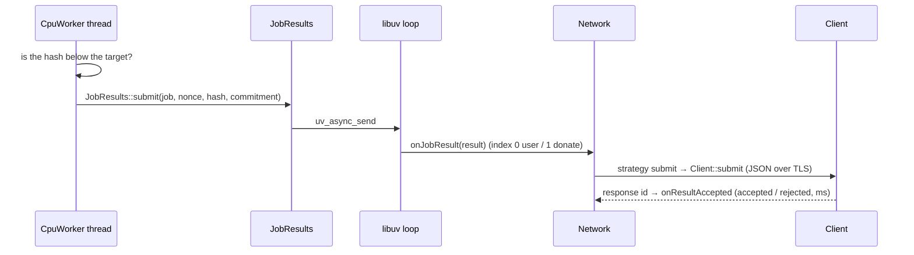

# 03 — Network, Stratum and TLS flow

All of this runs on the libuv loop thread. Main files:
`src/net/Network.cpp`, `src/base/net/stratum/{Client,Job,Pool,Pools,Url,Tls}.cpp`,
`src/base/net/stratum/strategies/{SinglePoolStrategy,FailoverStrategy}.cpp`,
`src/net/strategies/DonateStrategy.cpp`, `src/net/JobResults.cpp`.

## Layers

```
Network (IStrategyListener, IJobResultListener)        src/net/Network.cpp
 ├─ m_strategy : SinglePoolStrategy (1 enabled pool) | FailoverStrategy (>1)   Pools::createStrategy
 │    └─ Client  (stratum JSON-RPC over TCP, optional TLS / SOCKS5)            Client.cpp
 │         └─ Tls  (OpenSSL with memory BIOs; libuv owns the socket)           Tls.cpp
 ├─ m_donate   : DonateStrategy (own Failover/SinglePool of donate pools)
 └─ m_state    : NetworkState (accepted/rejected counters, latency, diff stats)
```

Other `IClient` implementations: `DaemonClient` (solo mining against monerod, `daemon+http(s)://`),
`SelfSelectClient` (`--self-select`), `AutoClient` (ETH/KawPow), `BenchClient` (benchmark mode).

## Connection state machine (`Client`)

`connect()` → DNS resolve (`Dns`, async, `--dns-ttl`) → `uv_tcp_connect` (TCP_NODELAY,
keepalive 60 s if the platform supports it) → `onConnect` → `handshake()`:
SOCKS5 first if configured → TLS handshake if `tls:true` (SNI = host when `sni:true`,
optional `--tls-fingerprint` pinning, checked in `Tls::verify`) → `login()`.

Timeouts (`Client::tick`, driven by `Network::tick` every 1 s): 20 s response timeout
(`kResponseTimeout`) for login/submit, keepalive ping (`keepalived` method) every 60 s
when enabled. On error: `close()` → strategy schedules reconnect after `retry-pause`
(5 s), failover moves to the next pool after `retries` (5) failures.

## Stratum messages (Monero/CryptoNote dialect)

**login** (sent by `Client::login`, `Network::onLogin` appends `algo`):

```json
{"id":1,"jsonrpc":"2.0","method":"login","params":{
  "login":"<WALLET>","pass":"x","agent":"XMRig/6.27.0 (Macintosh; macOS; arm64) libuv/1.x clang/x.y.z",
  "algo":["rx/0","rx/2","rx/wow", "..."]}}
```

**login result** → `Client::parseLogin`: `result.id` (rpc session id), `result.extensions`
(`algo`, `nicehash`, `connect`, `keepalive`, `tls`), `result.job`.

**job** (in login result or as `{"method":"job","params":{...}}` notification) →
`Client::parseJob`:

| Field | Parsing |
|---|---|
| `job_id` | `Job::setId` |
| `blob` | hex → `Job::m_blob` (max 408 bytes). Nonce lives at byte **39** (4 bytes) for RandomX/CryptoNote (`Job::nonceOffset`). A non-zero nonce in the blob ⇒ nicehash mode (only the low 24 bits are ours, `nonceMask`). |
| `algo` | optional; else `coin.algorithm(blob[0])` (blob major version ≥ 17 ⇒ `rx/2`) |
| `target` | 4-byte hex ⇒ `0xFFFFFFFFFFFFFFFF / (0xFFFFFFFF / t32)`, 8-byte ⇒ raw 64-bit; diff = `2^64-1 / target` |
| `height` | informational |
| `seed_hash` | **RandomX key (32 bytes)**; changes every 2048 blocks (~2.8 days) ⇒ cache + dataset rebuild |
| `sig_key` | Wownero-style miner signatures (not Monero) |

A duplicate job (same as current) triggers a reconnect (issue #459 guard).

**submit** (`Client::submit`):

```json
{"id":N,"jsonrpc":"2.0","method":"submit","params":{
  "id":"<rpc id>","job_id":"...","nonce":"<8 hex>","result":"<64 hex hash>",
  "commitment":"<64 hex, RandomX v2 only>","algo":"rx/0 (only if pool has the algo extension)"}}
```

The pool's reply is matched by `id` in `m_results` → `Network::onResultAccepted` logs
`accepted (a/r) diff D (latency ms)`.

## Job → Miner hand-off

`Client::parseNotification/parseResponse` → strategy → `Network::onJob` →
`Network::setJob` (logs `new job from host:port diff D algo A height H`) →
`Miner::setJob(job, donate)` (details in `04-mining-pipeline.md`).

While the donate strategy is active, jobs from the user pool are ignored
(`Network::onJob`) and vice versa; results are routed by `result.index`
(0 = user, 1 = donate) in `Network::onJobResult`.

## Donation (1 %)

`DonateStrategy`: after a random 49.5–148.5 min first period, mines 1 min per 100 min
(`m_donateTime = level*60 s`, `m_idleTime = (100-level)*60 s`) on
`donate.ssl.xmrig.com:443` (TLS) / `donate.v2.xmrig.com:3333`, user = keccak(your wallet).
It mirrors your algorithm/seed (`DonateStrategy::update`) so switching costs no dataset
rebuild, and nonces are not reset during donation rounds (#3785). Effect on your
earnings: exactly the donate level (1 %). The minimum level of 1 is a compile-time
constant (`kMinimumDonateLevel` in `src/donate.h`).

## Result path (worker → pool)



## Performance relevance of the network layer

Practically none for hashrate: the loop thread is idle >99 % of the time, and a job
change costs workers one sequence compare per hash. What can matter for *earnings*:

* **Stale/rejected shares** – latency to the pool. Pick the nearest nanopool region;
  TLS adds one handshake at connect time only.
* **Seed changes** (every ~2.8 days) pause mining for the dataset rebuild
  (5.6 s on 4 vCPUs here; tens of seconds on a laptop). The `Miner` keeps old jobs
  paused (`Nonce::pause(true)`) until `onDatasetReady`.
* **Donation**: 1 % of time.
